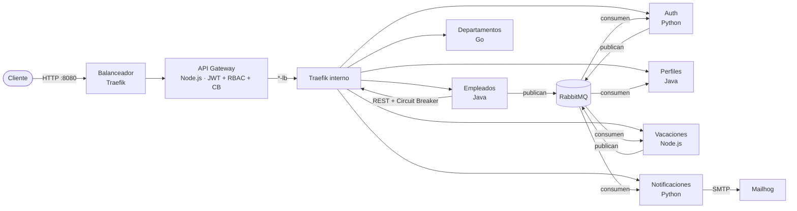

# Sistema de gestión del ciclo de vida del empleado — Proyecto final de Microservicios

Siete microservicios en **cuatro lenguajes** (Java, Go, Node.js y Python) que cubren el ciclo
completo de un empleado: **alta (onboarding), perfil, vacaciones y retiro (offboarding)**. Se
comunican por un API Gateway (síncrono) y por RabbitMQ (eventos), con seguridad JWT y RBAC,
observabilidad completa (logs, métricas, trazas y alertas), CI/CD en Jenkins con SonarQube y
Registry propio, y escalado horizontal detrás de un balanceador.

- Arquitectura detallada con diagramas: [`docs/arquitectura.md`](docs/arquitectura.md)
- Catálogo de eventos: [`docs/eventos.md`](docs/eventos.md)
- Guías de las herramientas: [`docs/guias/`](docs/guias/)
- Estado, plan y evidencias del proyecto: [`docs/proyecto-final/`](docs/proyecto-final/)
- Equivalencia con la estructura de entrega del PDF: [`docs/estructura-entrega.md`](docs/estructura-entrega.md)

## 1. Descripción y arquitectura



- **Síncrono:** el cliente solo habla con el Gateway (vía el balanceador). Empleados valida el
  departamento contra Departamentos con timeout, reintentos y circuit breaker.
- **Asíncrono:** eventos `empleado.*`, `usuario.*`, `cuenta.*` y `vacaciones.*` sobre un exchange
  topic, con deduplicación por id, reintentos y DLQ por consumidor.
- **Datos:** una base por servicio (PostgreSQL o MySQL), con migraciones versionadas y rollback.
- **Redes:** seis redes Docker por capa (`frontend`, `backend`, `messaging`, `data`,
  `observability`, `cicd`); ninguna base es alcanzable desde el borde.

## 2. Requisitos previos

| Herramienta | Versión mínima | Notas |
|---|---|---|
| Docker Engine / Docker Desktop | 27 (probado con 29.9) | En Windows, Docker Desktop con WSL 2 |
| Docker Compose | v2.32 | Incluido en Docker Desktop |
| Bash | 4+ | Git Bash en Windows o la terminal de Linux/macOS |
| Memoria para Docker | 8 GB (12 GB con Jenkins y SonarQube) | El stack completo levanta 30 contenedores |

No hace falta instalar Java, Go, Node ni Python: todo se compila y se prueba dentro de contenedores.

## 3. Instrucciones de ejecución

```bash
# Clonar o descomprimir el proyecto y entrar en la carpeta
cd microservicios

# Generar la configuración local (una sola vez): .env y secrets/ con valores aleatorios
cp .env.example .env          # opcional: setup-secrets lo crea desde la plantilla
bash scripts/setup-secrets.sh # en Windows también: .\scripts\setup-secrets.ps1

# Levantar todo el sistema
docker compose up --build

# (Opcional) Datos de prueba idempotentes, cargados por la API
bash scripts/seed-data.sh
```

| Servicio | URL |
|---|---|
| API Gateway (único puerto de negocio, detrás del balanceador) | http://localhost:8080 |
| Swagger UI agregada (los siete contratos) | http://localhost:8080/swagger |
| Grafana (dashboards y alertas) | http://localhost:3000 |
| Prometheus | http://localhost:9090 |
| Zipkin (trazas) | http://localhost:9411 |
| Jenkins | http://localhost:8090 |
| SonarQube | http://localhost:9000 |
| Docker Registry | http://localhost:5001/v2/_catalog |
| RabbitMQ (administración) | http://localhost:15672 |
| Mailhog (correos de prueba) | http://localhost:8025 |

Operación diaria:

| Comando | Efecto |
|---|---|
| `docker compose ps` | Estado y salud de todos los contenedores |
| `docker compose down` | Apaga conservando los datos (volúmenes) |
| `docker compose down -v` | Apaga y **borra** todos los datos (reinicio total) |
| `docker compose up -d --scale empleados-service=2` | Escala un servicio; el balanceador reparte solo |

## 4. Tecnologías utilizadas

| Microservicio | Lenguaje / framework | Base de datos | Puerto interno | Responsabilidad |
|---|---|---|---|---|
| `api-gateway` | Node.js 22 + Express | — | 8080 | Borde: JWT, RBAC, proxy, circuit breaker, Swagger agregada |
| `empleados-service` | Java 21 + Spring Boot 4 | PostgreSQL 16 | 8080 | Alta, actualización, retiro y auditoría de empleados |
| `departamentos-service` | Go 1.25 + chi | MySQL 8.4 | 8081 | CRUD de departamentos |
| `auth-service` | Python 3.12 + FastAPI | PostgreSQL 16 | 8086 | Cuentas, login JWT, activación, recuperación y estados |
| `perfiles-service` | Java 21 + Spring Boot 4 | PostgreSQL 16 | 8083 | Perfil del empleado, sincronizado por eventos |
| `vacaciones-service` | Node.js 22 + Express | PostgreSQL 16 | 8085 | Períodos de vacaciones y scheduler de inicio/fin |
| `notificaciones-service` | Python 3.12 + FastAPI | PostgreSQL 16 | 8084 | Correos por evento e historial de notificaciones |

| Componente | Herramienta |
|---|---|
| Message broker | RabbitMQ 3.13 (exchange topic `onboarding.eventos`, DLX `onboarding.dlx`) |
| Balanceador | Traefik 3.6 (health checks activos, reintento entre réplicas) |
| Logs | Loki + Promtail (JSON estructurado, contrato C5) |
| Métricas y alertas | Prometheus + Grafana (alertas a Discord y correo) |
| Trazas | OpenTelemetry + Zipkin (W3C `traceparent` en HTTP y AMQP) |
| CI/CD | Jenkins (JCasC) + SonarQube + Docker Registry local |
| Seguridad | Docker Compose Secrets, Gitleaks, Trivy |

## 5. Endpoints principales del API Gateway

Todas las rutas pasan por `http://localhost:8080`. Salvo login, recuperación y reset, todas exigen
`Authorization: Bearer <token>`. `USER` solo lee (más cambiar su contraseña y editar **su** perfil);
`ADMIN` puede todo. Los errores siguen el contrato C3 (`timestamp, status, error, message, path, traceId`).

| Método y ruta | Rol | Descripción |
|---|---|---|
| `POST /auth/login` | público | Devuelve un access JWT |
| `POST /auth/recover-password` · `POST /auth/reset-password` | público | Recuperación y activación de cuenta |
| `POST /auth/change-password` | USER/ADMIN | Cambio de contraseña propia |
| `GET/POST /empleados` · `GET/PUT/DELETE /empleados/{id}` | lectura USER · escritura ADMIN | Ciclo de vida del empleado (`DELETE` = retiro lógico) |
| `GET/POST /departamentos` · `GET/PUT/DELETE /departamentos/{id}` | lectura USER · escritura ADMIN | Departamentos |
| `GET /perfiles` · `GET/PUT /perfiles/{empleadoId}` | `PUT` solo el dueño o ADMIN | Perfil del empleado |
| `GET/POST /vacaciones` · `GET/PUT/DELETE /vacaciones/{id}` | lectura USER · escritura ADMIN | Períodos de vacaciones |
| `GET /notificaciones` · `GET /notificaciones/{empleadoId}` | USER/ADMIN | Historial de correos |
| `GET /health` · `GET /metrics` · `GET /swagger` | público | Salud, métricas y documentación |

Ejemplo de onboarding completo con `curl`:

```bash
BASE=http://localhost:8080
TOKEN=$(curl -s -X POST $BASE/auth/login -H 'Content-Type: application/json' \
  -d "{\"usuario\":\"admin\",\"contrasena\":\"$(cat secrets/auth_admin_password.txt)\"}" \
  | sed -n 's/.*"token":"\([^"]*\)".*/\1/p')

curl -s -X POST $BASE/departamentos -H "Authorization: Bearer $TOKEN" -H 'Content-Type: application/json' \
  -d '{"id":"TI","nombre":"Tecnología","descripcion":"Área de sistemas"}'

curl -s -X POST $BASE/empleados -H "Authorization: Bearer $TOKEN" -H 'Content-Type: application/json' \
  -d '{"id":"E100","nombre":"Ana","apellido":"Pérez","email":"ana.perez@empresa.com","numeroEmpleado":"N-100",
       "cargo":"Analista","area":"TI","departamentoId":"TI","fechaIngreso":"2026-01-15","estado":"ACTIVO"}'

# Segundos después: cuenta creada en Auth, perfil en Perfiles y correo de activación en Mailhog
curl -s $BASE/notificaciones/E100 -H "Authorization: Bearer $TOKEN"
curl -s -X POST $BASE/vacaciones -H "Authorization: Bearer $TOKEN" -H 'Content-Type: application/json' \
  -d '{"empleadoId":"E100","fechaInicio":"2027-03-15","fechaFin":"2027-03-19"}'
curl -s -X DELETE $BASE/empleados/E100 -H "Authorization: Bearer $TOKEN"   # offboarding
```

## 6. Configuración inicial y secretos

- `.env.example` es la plantilla versionada; `.env` y `secrets/` están en `.gitignore`.
- `scripts/setup-secrets.sh` (o `.ps1`) copia la plantilla a `.env` y genera **16 secretos**
  aleatorios en `secrets/*.txt` (contraseñas de bases, RabbitMQ, JWT, administrador semilla,
  Jenkins, SonarQube, Grafana y usuario de pruebas E2E). El webhook de Discord se toma de la
  variable `DISCORD_WEBHOOK_URL` al generar (ver [`docs/guias/alertas-discord.md`](docs/guias/alertas-discord.md)).
- Los contenedores reciben los secretos como **Docker Compose Secrets** en `/run/secrets/<nombre>`
  y los leen con variables `*_FILE`; ningún secreto aparece en `docker-compose.yml` ni en imágenes.
- Variables principales de `.env`: nombres de bases y usuarios, puertos de host de las herramientas,
  parámetros de resiliencia (`CB_*`, `PROXY_*`), del scheduler (`VACACIONES_CRON`) y de
  observabilidad (`OTEL_*`, `GRAFANA_ALERT_EMAIL`). Cada una está comentada en `.env.example`.
- **Rotación:** `bash scripts/setup-secrets.sh --force` rota todos los valores; el procedimiento
  completo (incluida la revocación específica) está en
  [`docs/proyecto-final/SEGURIDAD-SECRETOS.md`](docs/proyecto-final/SEGURIDAD-SECRETOS.md).
- **Verificación:** `bash scripts/scan-secrets.sh` (árbol) y `--history` (historial) con Gitleaks.

## 7. Accesos por defecto

Ninguna contraseña real aparece en este documento: cada credencial sale del archivo de secreto indicado.

| Acceso | Usuario | Contraseña |
|---|---|---|
| Administrador semilla del sistema (rol ADMIN) | `AUTH_ADMIN_USUARIO` (`.env`, por defecto `admin`) | `secrets/auth_admin_password.txt` |
| Grafana | `GRAFANA_ADMIN_USER` (por defecto `admin`) | `secrets/grafana_admin_password.txt` |
| Jenkins | `JENKINS_ADMIN_ID` (por defecto `admin`) | `secrets/jenkins_admin_password.txt` |
| SonarQube | `admin` | `secrets/sonar_admin_password.txt` |
| RabbitMQ | `RABBITMQ_USER` (por defecto `onboarding`) | `secrets/rabbitmq_password.txt` |

El administrador semilla lo crea `auth-service` al arrancar si no existe. Los empleados no tienen
contraseña inicial: reciben por correo (Mailhog) un enlace de activación con un token de un solo uso.

## Pruebas

| Comando | Qué ejecuta |
|---|---|
| Comando unitario de cada servicio (ver su README) | Unitarias + cobertura con umbral 70 % + JUnit |
| `bash scripts/test-integration.sh` | Integración contra PostgreSQL, MySQL, RabbitMQ y SMTP reales |
| `bash scripts/test-mutation.sh` | Un mutante por servicio que debe hacer fallar la suite |
| `bash scripts/test-bdd.sh 3` | BDD (Cucumber, 23 escenarios) tres veces contra el stack |
| `bash scripts/demo-escalado.sh` | Dos réplicas, reparto de tráfico y caída de una réplica sin errores |
| `bash scripts/deploy.sh <servicio> <tag>` · `rollback <servicio>` | Despliegue desde el Registry con smoke test y rollback |

Los siete servicios tienen pipeline en Jenkins (generado desde
[`jenkins/plantillas/`](jenkins/plantillas/)) con build, lint, unitarias, integración, SonarQube con
Quality Gate, análisis de seguridad, imagen con tag inmutable, push al Registry, E2E y despliegue.

## Estructura del repositorio

```
├── docker-compose.yml           # orquestación completa (6 redes, secretos, healthchecks)
├── docker-compose.deploy.yml    # despliegue desde el Registry por tag (Fase 10)
├── .env.example · secrets.example/
├── services/<servicio>/         # Dockerfile, Jenkinsfile, openapi.yaml, src/, pruebas, README
├── e2e-tests/                   # BDD con Cucumber.js
├── observability/               # Prometheus, Grafana (dashboards y alertas), Loki, Promtail
├── infrastructure/              # imágenes de RabbitMQ y Traefik con su configuración
├── jenkins/                     # Jenkins (JCasC), plantilla de pipelines, bootstrap de Sonar
├── scripts/                     # secretos, semilla, pruebas, despliegue y demostraciones
└── docs/                        # arquitectura, eventos, guías, proyecto final e historial de retos
```
