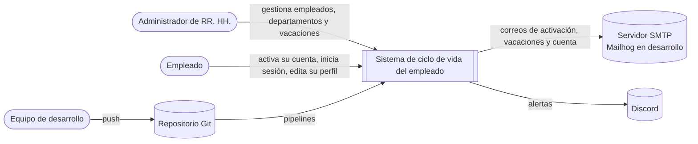
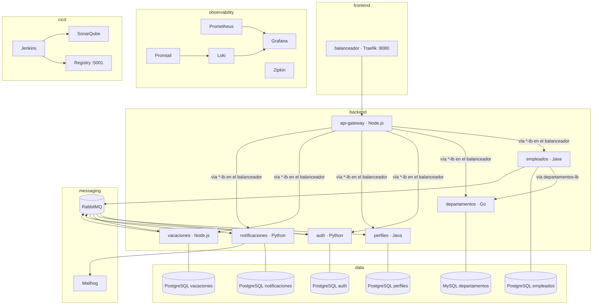
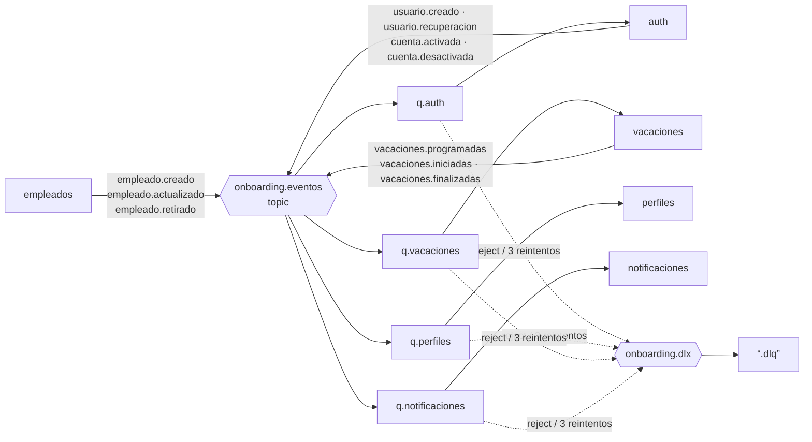
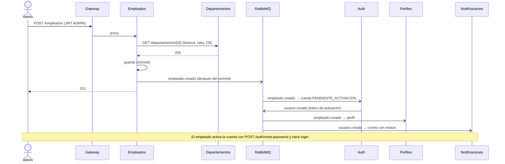
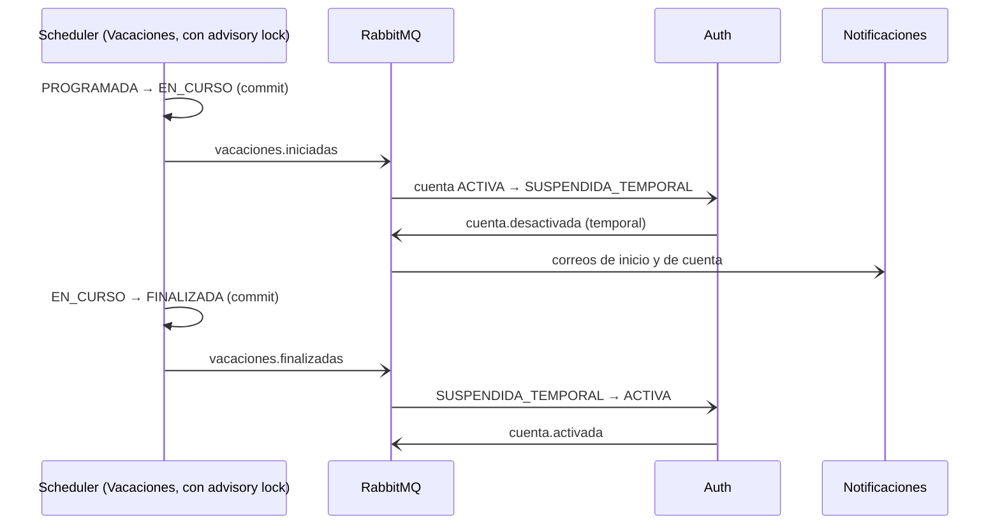
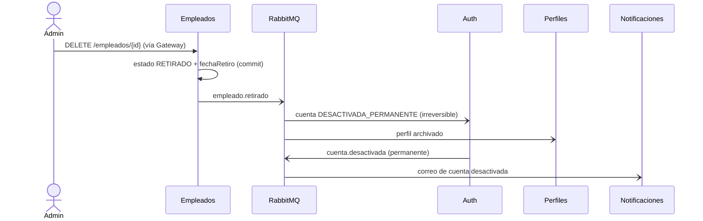
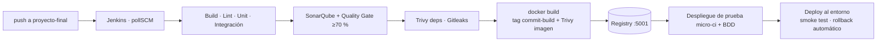

# Arquitectura

Visión técnica del sistema de gestión del ciclo de vida del empleado. Los contratos compartidos
(envelope de eventos C1, health C2, error C3, métricas C4, logs C5 y plantilla de README C6) están
en [`proyecto-final/PLAN-PROYECTO-FINAL.md`](proyecto-final/PLAN-PROYECTO-FINAL.md).

## 1. Contexto

## 2. Contenedores

| Red | Miembros | Propósito |
|---|---|---|
| `frontend` | balanceador | Único punto de entrada de negocio (:8080) |
| `backend` | balanceador, Gateway y los seis servicios | HTTP interno; el balanceador publica los alias `<servicio>-lb` |
| `messaging` | RabbitMQ, Mailhog y los servicios que publican o consumen | Eventos y SMTP |
| `data` | cada base con su servicio | Ninguna base es alcanzable desde el borde ni desde CI |
| `observability` | Prometheus, Loki, Promtail, Zipkin, Grafana, los siete servicios y el balanceador | Métricas, logs y trazas |
| `cicd` | Jenkins, SonarQube, su base, Registry | CI/CD aislado de los datos de negocio |

## 3. Eventos

Cada consumidor deduplica por el `id` del envelope en la misma transacción que su efecto, reintenta
tres veces con espera de 5 s (`<q>.retry`) y envía a su DLQ los mensajes inválidos o agotados. El
detalle por evento está en [`eventos.md`](eventos.md).

## 4. Secuencias de negocio

### Onboarding

### Vacaciones

### Offboarding

## 5. Resiliencia y escalabilidad

- **Gateway → servicios:** circuito independiente por backend, timeout por servicio, reintento con
  backoff 1–2–4 s solo en `GET`, fallback 503 C3.
- **Empleados → Departamentos:** Resilience4j (timeout 5 s, backoff 1–2–4 s, circuit breaker); con
  el circuito abierto el empleado queda `PENDIENTE_VALIDACION` y se reconcilia después.
- **Balanceador (Traefik):** descubre las réplicas de su proyecto Compose, las verifica con health
  checks activos a `/health` cada 5 s, reintenta en otra réplica ante errores de conexión y, si un
  servicio se queda sin réplicas, responde 502 (el Gateway lo convierte en 503 y abre el circuito).
- **Escalado:** ningún servicio publica puerto ni usa `container_name`; `docker compose up --scale
  <servicio>=2` funciona en los siete. Los consumidores compiten por la misma cola y la deduplicación
  evita efectos dobles; el scheduler de Vacaciones toma un `pg_try_advisory_lock` por tick.

## 6. CI/CD y despliegue

- Los siete `Jenkinsfile` se generan desde [`../jenkins/plantillas/`](../jenkins/plantillas/).
- `docker-compose.deploy.yml` sustituye el `build` de un servicio por la imagen del Registry con el
  tag inmutable; `scripts/deploy.sh` despliega, verifica salud y revierte al tag anterior si falla.
- Cada imagen lleva las etiquetas `org.opencontainers.image.revision` (commit) y `version` (tag):
  commit → imagen → contenedor es trazable con `docker inspect`.

## 7. Observabilidad

| Señal | Implementación |
|---|---|
| Métricas | Cada servicio expone `/metrics` (o `/actuator/prometheus`) con HTTP, CPU/memoria y métricas de negocio; Prometheus descubre cada réplica por DNS |
| Logs | JSON con `timestamp, level, service, message, traceId, spanId`; Promtail los envía a Loki con labels `service` y `level` |
| Trazas | OpenTelemetry con propagación W3C en HTTP y AMQP; una traza de onboarding recorre los siete servicios en Zipkin |
| Alertas | Grafana: servicio caído, 5xx > 10 %, p95 > 2 s, mensajes en DLQ y memoria > 85 %; envío a Discord y correo |
