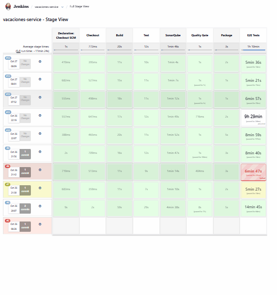
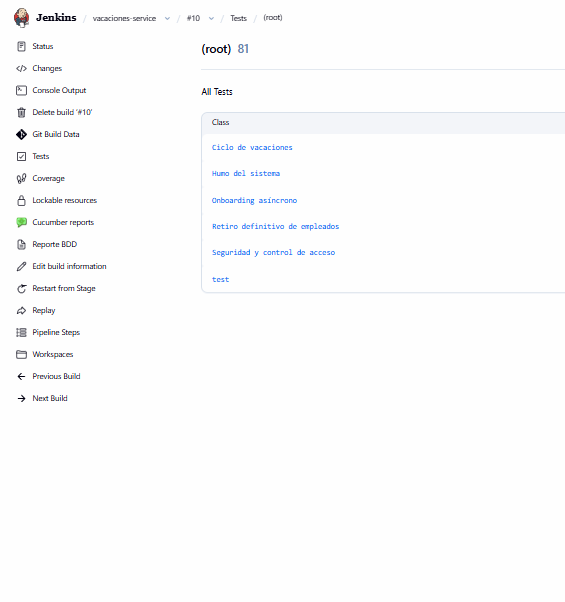
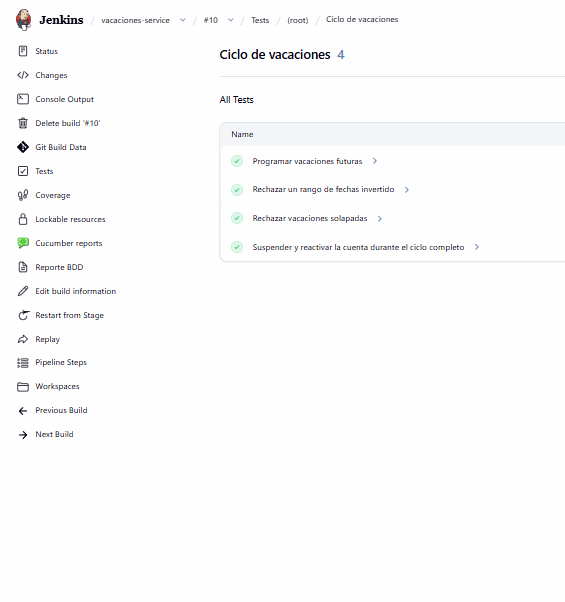
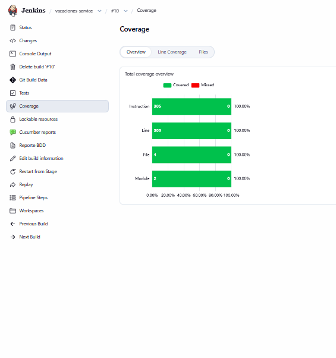
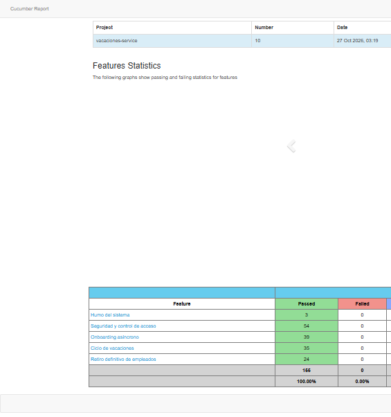
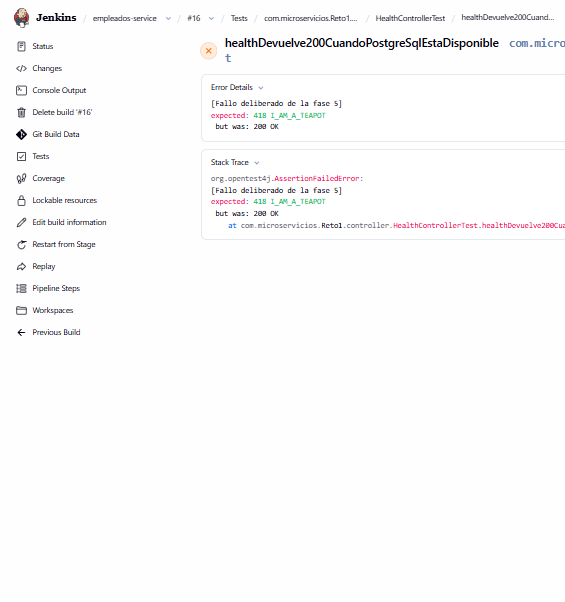
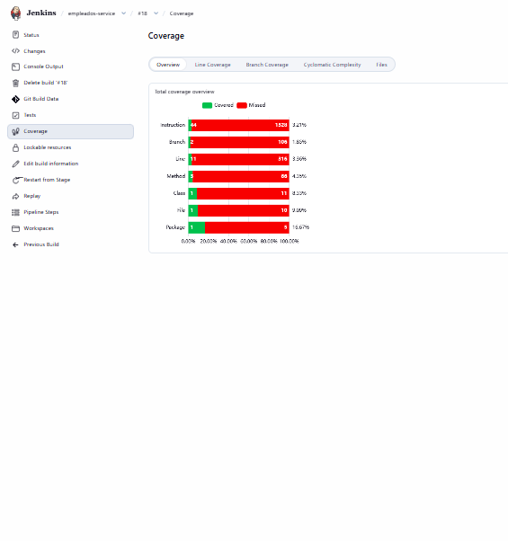
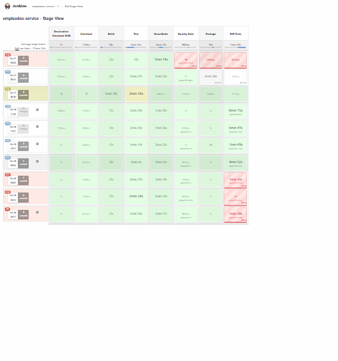
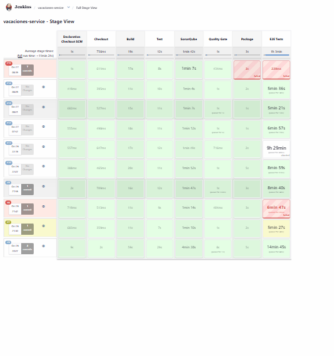
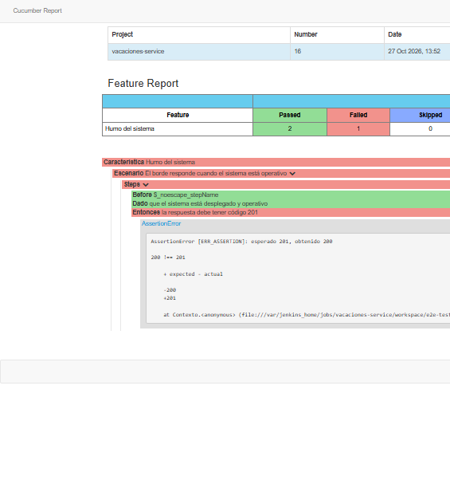

# Evidencias — Reto 7

Lo que ya se vio en marcha. La fase 5 cierra el criterio de capturas: pipeline en verde,
Test Result, Coverage, reporte BDD en español y los cuatro fallos en la etapa que
corresponde.

## Fase 1 — job `verificar-docker`, build 3, SUCCESS

Consola del 26 oct 2026, usuario `admin`, [http://localhost:9090](http://localhost:9090):

```
Jenkins está correctamente configurado
+ docker --version
Docker version 27.5.1, build 9f9e405
+ docker compose version
Docker Compose version v2.32.4
+ docker ps
... jenkins, sonarqube (healthy), sonar-db (healthy) ...
Finished: SUCCESS
```

El build 1 falló porque el script inline estaba fuera del sandbox y Jenkins exigía
aprobarlo a mano. El build 2 llegó a la etapa y `docker` no estaba en el `PATH` (Debian 13
instala `dockerd` con `docker.io` y no el cliente). El build 3 es el que cierra la fase.

## Fase 3 — Quality Gate `Reto7`

`GET /api/qualitygates/show?name=Reto7` después de `sonar-bootstrap`:

| Condición | Operador | Umbral |
|---|---|---|
| `coverage` | LT | 70 |
| `new_coverage` | LT | 70 |

Es el gate por defecto. Sonar, al crear el gate, agrega condiciones de «clean as you code»
(cobertura nueva al 80 %, violaciones, hotspots, duplicación). El bootstrap las quita y deja
las dos del plan. El token queda en el volumen `sonar_bootstrap`, no en Git. SonarQube 26
rechaza el webhook hacia la red de Docker; `sonar.validateWebhooks=false` lo deja llegar a
Jenkins.

Dashboard de `empleados-service` tras el análisis del build 5, con el gate en Passed:

| Métrica | Valor |
|---|---|
| Cobertura | 83,9 % |
| Bugs | 0 |
| Vulnerabilidades | 1 |
| Code smells | 2 |
| Duplicación | 6,4 % |
| Quality Gate | OK |

El stage del build 5 imprimió `Quality gate is 'OK'`.

Build 7, pruebas quitadas salvo `HealthControllerTest` (2 passed, 0 failed). JaCoCo quedó en
3,36 % de líneas y 3,21 % de instrucciones. El stage Quality Gate cortó el pipeline:

```
Quality gate is 'ERROR'
Stage "Package" skipped due to earlier failure(s)
Stage "E2E Tests" skipped due to earlier failure(s)
ERROR: Pipeline aborted due to quality gate failure: ERROR
Finished: FAILURE
```

Esas pruebas se restauraron. El build 8 volvió a analizar la suite completa y el stage
imprimió `Quality gate is 'OK'`.

## Fase 2 — Test Result, cobertura y una unitaria rota

Job `empleados-service`, checkout `file:///workspace` rama `main`. El build 1 no encontró el
Jenkinsfile; a partir del build 2 el pipeline publica Surefire, Failsafe y JaCoCo.

| Build | Test Result | Cobertura de línea | Instrucciones | Resultado del job |
|---|---|---|---|---|
| 2 | 79 passed, 0 failed | 88,07 % | 88,41 % | FAILURE más adelante (el gate aún no autenticaba) |
| 3 | 79 passed, 0 failed | 88,07 % | 88,41 % | FAILURE más adelante |
| 4 | 79 passed, 0 failed | 88,07 % | 88,41 % | ABORTED en el Quality Gate |
| 5 | 79 passed, 0 failed | 88,07 % | 88,41 % | siguió de largo; la etapa Test ya había publicado |
| 6 | 78 passed, 1 failed | 88,07 % | 88,41 % | UNSTABLE |

La segunda ejecución (build 3) ya tiene la cobertura del build 2. La gráfica de tests está en
`/job/empleados-service/test/trend` (responde `image/png`).

Build 6, pestaña Test Result, sin abrir la consola:

- Clase: `com.microservicios.Reto1.controller.HealthControllerTest`
- Prueba: `healthDevuelve200CuandoPostgreSqlEstaDisponible`
- Estado: FAILED
- Mensaje: `[Fallo deliberado de la fase 2] expected: 418 I_AM_A_TEAPOT but was: 200 OK`

Ese fallo marcó el build UNSTABLE y `skipStagesAfterUnstable()` no entró a SonarQube, Quality
Gate, Package ni E2E. La aserción se revirtió; `main` vuelve a esperar `HttpStatus.OK`.

## Fase 4 — imagen, E2E y `vacaciones-service`, build 6, SUCCESS

`empleados-service` build 12 ya había cerrado la corrida verde de ese pipeline. Los builds 1
a 5 de vacaciones murieron en E2E (cookie de RabbitMQ, MySQL en frío, Postgres en frío y el
broker unhealthy). El build 6, el 26 oct 2026, recorrió Checkout, Build, Test, SonarQube,
Quality Gate, Package y E2E Tests en SUCCESS.

`docker image inspect` devuelve la misma imagen para `micro/vacaciones-service:6` y
`:latest`.

Test Result del build 6, sin abrir la consola: 81 passed, 0 failed. La suite Cucumber aporta
18 escenarios. En español aparecen, entre otros:

- Programar vacaciones futuras
- Rechazar un rango de fechas invertido
- Rechazar vacaciones solapadas
- Suspender y reactivar la cuenta durante el ciclo completo
- Retirar conserva auditoría y bloquea la cuenta
- La recuperación no vuelve a habilitar una cuenta retirada

El enlace «Reporte BDD» responde en
`/job/vacaciones-service/6/Reporte_20BDD/cucumber.html` y el HTML nombra las características
«Ciclo de vacaciones» y «Retiro definitivo». El artefacto del build es `docker-logs.txt`.
La pestaña Coverage responde.

SonarQube, proyecto `vacaciones-service`, gate `Reto7` en Passed:

| Métrica | Valor |
|---|---|
| Cobertura | 98,8 % |
| Bugs | 4 |
| Vulnerabilidades | 3 |
| Code smells | 0 |
| Duplicación | 0,0 % |
| Quality Gate | OK |

Al terminar, `docker compose -p micro-ci down -v` no dejó contenedores `micro-ci`. Siguieron
arriba `jenkins`, `sonarqube` y `sonar-db`, y los volúmenes `jenkins_data` y `sonar_bootstrap`.

## Fase 5 — tres corridas y cuatro fallos

El volumen `jenkins_data` no se borró entre corridas. `empleados-service` builds 13, 14 y
15 (26 oct 2026) y `vacaciones-service` builds 12, 13 y 14 (27 oct 2026) terminaron en
SUCCESS, uno detrás de otro.

Antes de esa racha de vacaciones, el build 7 falló por un corte TCP (`fetch failed` en
`forzar-fin`; el gateway no vio la petición) y el build 8 por el healthcheck: empleados
arrancó en 287 s y el presupuesto anterior se agotaba cerca del segundo 220. Esas dos
causas quedaron corregidas en `main`. El build 11 se abortó porque Docker se cayó de
noche; no forma parte de la racha.

Pipeline en verde, Test Result, Coverage y el reporte BDD del build 10 de vacaciones:











Los cuatro fallos se provocaron en `main`, se capturaron y se revirtieron. El árbol vuelve
a tener la suite de empleados, el Dockerfile de vacaciones y el humo esperando 200.

1. `empleados-service` build 16, UNSTABLE. Test queda en amarillo. Test Result nombra
   `healthDevuelve200CuandoPostgreSqlEstaDisponible`: «Fallo deliberado de la fase 5»,
   expected 418 I_AM_A_TEAPOT, was 200 OK. Sonar, Quality Gate, Package y E2E no corrieron.



2. `empleados-service` build 18, FAILURE. Líneas al 3,36 %. Quality Gate `ERROR`
   (`Quality gate is 'ERROR'`). Package y E2E no corrieron. El build 17, con el código
   excluido de Sonar, no bajó la medida y se abortó: no es este fallo.





3. `vacaciones-service` build 15, FAILURE. Package en rojo. `RUN this-command-does-not-exist`
   devolvió 127 (`not found`). E2E no corrió.



4. `vacaciones-service` build 16, UNSTABLE. Se detiene en E2E Tests. Cucumber nombra el
   escenario «El borde responde cuando el sistema está operativo»: esperado 201, obtenido
   200.


